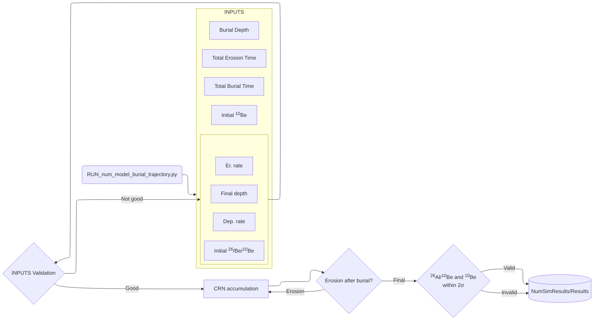

<p style="line-height: 150%;">
<strong>Author:</strong> Pedro Oliveira<br>
<strong>GitHub:</strong> <a href="https://github.com/thepedroland">@thepedroland</a>

The content in this repository can be used to reproduce the plots and generate results presented in *[X]*

---
## Overview

The numerical burial model simulates the accumulation of cosmogenic nuclides for buried samples with in depth with continous production.

- **Scaling method:** LSDn
- **Production pathways modeled:**
  - **Spallation**: average scaled from scaling factor CRONUS Calc based on area latitude and altitude
  - **Negative muon capture and fast muons**: calculated as a function of depth and Rc using Balco (2008)
    - **Time-varying cutoff rigidity (Rc)**: calibrated from Mijjum et al. (2025) dataset

- The constants used can be found [here](z_AuxDataScripts/aux_scripts/models_constants.py)
---
## Model Flowchart



## Repository structure (to be updated)

```
numerical_MC_Burial_Ages_PO/
├── AuxDataScripts/
│   ├── aux_functions/              # Core functions used by the numerical model
│   │   ├── models_constants.py     # Model constants and production parameters
│   │   ├── nuclide_prod_concentration.py
│   │   ├── solution_trajectories.py
│   │   └── misc_functions.py
│   └── data/                       # Input and auxiliary datasets
│       ├── TablesCosmo/            # Cosmogenic-nuclide production/scaling tables
│       └── TopographicData/        # Topographic, erosion-rate, and sample datasets
├── DataResults/
│   ├── ScriptsData/                # Scripts used to run numerical simulations
│   │   └── RUN_num_model_burial_trajectory.py
│   └── NumSimResults/              # Numerical model output files
├── Figures/
│   ├── ScriptsFig/                 # Scripts used to reproduce paper figures
│   │   ├── Fig2A_Banana_Plot.py
│   │   ├── Fig2B_S5_Sec_equilibrium.py
│   │   ├── Fig3_S2toS6_Age_solutions.py
│   │   ├── Fig4_york_regression_erosion_rate_ksn_graph.py
│   │   └── FigS3_calc_Rc.py
│   └── Plots/                      # Generated figure files
├── README.md                       # Repository documentation
└── .gitignore                      # Files ignored by Git
```

---

## Software/Packages Requirements 
Versions are listed as the ones working when results were generated for this paper. Newer versions might be available, 
however, it is not guaranteed they will work smoothly.

| Package      | Version |
|--------------|---------|
| Python       | 3.13.12 |
| MATLAB       | 2026a   |
| matlabengine | 26.1    |
| numpy        | 2.3.5   |
| pandas       | 2.3.3   |
| torch        | 2.11.0  |
| matplotlib   | 3.10.8  |

Note: topographic datasets were generated using MATLAB 2025a, with [TopoToolbox (v2.5)](https://github.com/wschwanghart/topotoolbox)

---
## Usage

<p style="line-height: 150%;">
<strong>Reproduce dataset:</strong> Run MC simulations and generate results using <a href="a_DataResults/ScriptsGenerateData/RUN_num_model_burial_trajectory.py">this script</a><br>
<strong>Plots</strong> Plots can be reproduced using <a href="a_Figures/ScriptsGeneratePlots">these scripts</a>

**Note**: if you want to use the banana plot but for your own data use the structure in 
_Fig2A_Banana_Plot.py_ - you have to calibrate for the production rate of your study area!

---
## References

- Greg Balco, Production rate calculations for cosmic-ray-muon-produced 10Be and 26Al benchmarked against geological calibration data, Quaternary Geochronology, Volume 39,
2017, Pages 150-173, ISSN 1871-1014,https://doi.org/10.1016/j.quageo.2017.02.001. (https://www.sciencedirect.com/science/article/pii/S1871101416301649)

- Mijjum, M., Bristol, K. E., Bono, R. K., Sprain, C. J., Lifton, N., 
& Tremblay, M. M. (2025). A model framework for scaling pre‐quaternary cosmogenic nuclide production rates. Geochemistry, Geophysics, Geosystems, 26,  e2024GC012020. https://doi.org/10.1029/ 2024GC012020

- Schwanghart, W., Scherler, D. (2014): TopoToolbox 2 – MATLAB-based software for topographic analysis and modeling in Earth surface sciences. Earth Surface Dynamics, 2, 1-7. DOI: 10.5194/esurf-2-1-2014

---
## Citation
If you use any part of the scripts in this repository please cite the paper as:
- ...
